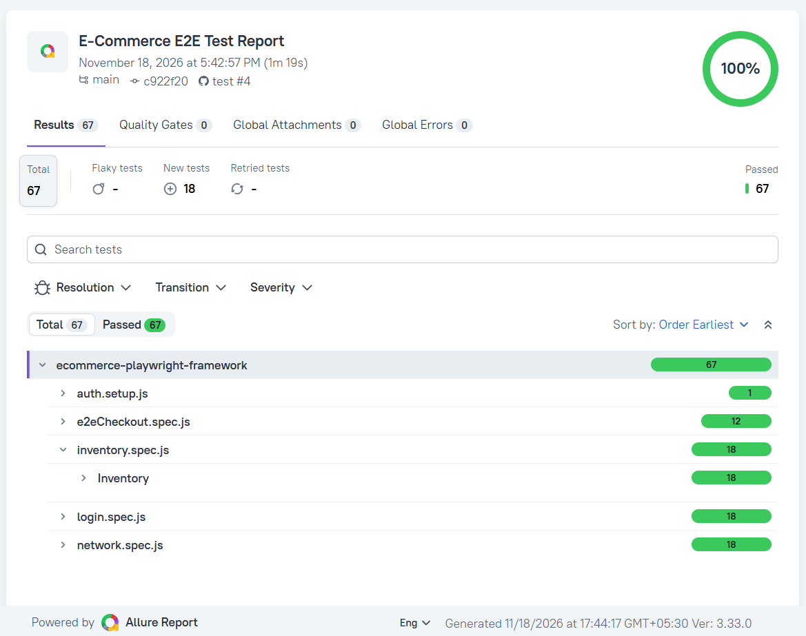
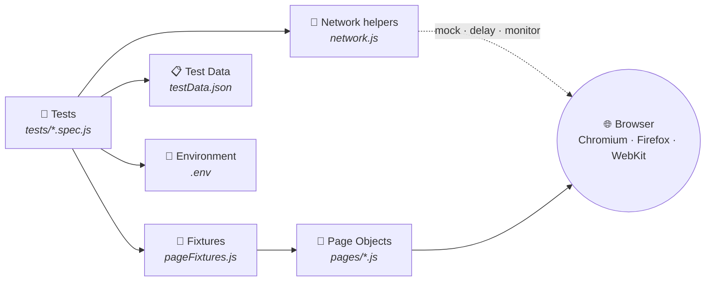
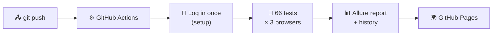

<div align="center">

# 🛒 E-Commerce End-to-End UI Automation Framework

**A production-style test automation framework built with Playwright and JavaScript.**
It tests a real e-commerce flow from login to order confirmation on three browsers, checks how the site copes with network failures, and publishes a live Allure report on every push.

[](https://github.com/Pubudugunawardhana/E-Commerce-End-to-End-UI-Automation-Framework/actions/workflows/playwright.yml)
[](https://pubudugunawardhana.github.io/E-Commerce-End-to-End-UI-Automation-Framework/)
[](LICENSE)


**[📊 Live Test Report](https://pubudugunawardhana.github.io/E-Commerce-End-to-End-UI-Automation-Framework/)** ·
**[⚙️ CI Runs](https://github.com/Pubudugunawardhana/E-Commerce-End-to-End-UI-Automation-Framework/actions)** ·
**[🚀 Quick Start](#-quick-start)**

</div>

---

## 📑 Table of contents

- [Highlights](#-highlights)
- [Live report](#-live-report)
- [Test coverage](#-test-coverage)
- [Network mocking](#-network-mocking)
- [Architecture](#️-architecture)
- [Quick start](#-quick-start)
- [Commands](#-commands)
- [CI/CD pipeline](#-cicd-pipeline)
- [Project structure](#-project-structure)
- [Adding test data](#-adding-test-data)
- [Debugging a failed test](#-debugging-a-failed-test)
- [Security](#-security)
- [License](#-license)

---

## ✨ Highlights

| | Feature | What it means |
|---|---|---|
| 🧱 | **Page Object Model** | Each page's locators and actions live in their own class. If the UI changes, the fix goes in one place. |
| 🧩 | **Custom fixtures** | Tests ask for `loginPage`, `cartPage` and so on, and Playwright creates them. Tests don't need `new` statements. |
| 📋 | **Data-driven tests** | Scenarios are stored in JSON. Add a row, and you get a new test without writing any code. |
| ⚡ | **Log in once** | A setup step logs in once and saves the session, so the tests start already logged in. |
| 🔐 | **Secrets in `.env`** | Credentials stay out of the code and out of Git. In CI they come from GitHub Secrets. |
| 🌐 | **Cross-browser** | Every test runs on Chromium, Firefox and WebKit. |
| 📡 | **Network mocking** | `page.route()` simulates failed requests, a mocked HTTP 503, a slow network and offline mode, and a monitor catches failed requests and JavaScript errors. |
| 📊 | **Allure reporting** | Severity levels, features and stories, step-by-step logs, and history trends. |
| 🎥 | **Debugging on failure** | A failed test keeps a screenshot, a video and a Playwright trace. |
| 🚀 | **CI/CD** | Every push runs the suite in GitHub Actions and deploys the report to GitHub Pages. |

---

## 📊 Live report

The latest results are always online. No setup is needed:
**👉 [pubudugunawardhana.github.io/E-Commerce-End-to-End-UI-Automation-Framework](https://pubudugunawardhana.github.io/E-Commerce-End-to-End-UI-Automation-Framework/)**

<p align="center">
  
</p>

---

## 🧪 Test coverage

The tests run against [Sauce Demo](https://www.saucedemo.com), a public demo shop built for practising test automation.

| ID | Scenario | Feature | Severity | Runs |
|---|---|---|---|---|
| TC01 | A valid user can log in | Login | 🔴 Blocker | 1 |
| TC02 | Login fails with the right error message: locked out user, wrong password, unknown user, empty username, empty password | Login | 🟠 Critical | 5 |
| TC03 | Products sort correctly: name A–Z and Z–A, price low–high and high–low | Product catalogue | 🟢 Normal | 4 |
| TC04 | Adding and removing products updates the cart badge | Shopping cart | 🟠 Critical | 1 |
| TC05 | A user can log out | Login | 🟢 Normal | 1 |
| TC06 | **Full checkout:** add products, check the cart, enter customer details, check the subtotal, tax and total, and place the order | Checkout | 🔴 Blocker | 1 |
| TC07 | Checkout shows an error for each missing required field | Checkout | 🟢 Normal | 3 |
| TC08 | The shop still works when product images fail, web fonts fail, or the error-reporting service returns **HTTP 503** (mocked) | Network resilience | 🟢 Normal | 3 |
| TC09 | Checkout completes when every request is delayed (slow network) | Network resilience | 🟢 Normal | 1 |
| TC10 | The cart and checkout keep working after the connection drops (offline mode) | Network resilience | 🟢 Normal | 1 |
| TC11 | A full checkout makes no failed requests to the site and throws no JavaScript errors | Network resilience | 🟠 Critical | 1 |

That makes **22 tests per browser × 3 browsers = 66 tests**, plus 1 login setup step.

> [!NOTE]
> **Found by TC11:** the server answers direct links to inner pages (for example `/inventory.html`) with **HTTP 404**, even though the React app still renders the page. The network tests therefore start from the login page, like a real user.

---

## 📡 Network mocking

Real users don't always have a perfect connection. These tests use Playwright's network control to check how the shop behaves when things go wrong:

| Technique | Playwright API | Used in |
|---|---|---|
| **Fail requests:** abort them, or return a mocked HTTP error | `page.route()` + `route.abort()` / `route.fulfill()` | TC08 |
| **Slow network:** hold every request before letting it through | `page.route()` + `route.continue()` | TC09 |
| **Offline mode:** cut the connection mid-session | `context.setOffline(true)` | TC10 |
| **Monitoring:** record failed responses and uncaught errors | `page.on('response')`, `page.on('requestfailed')`, `page.on('pageerror')` | TC11 |

The helpers live in [`utils/network.js`](ecommerce-playwright-framework/utils/network.js), and the failure scenarios are data-driven:

```json
{
  "title": "the error-reporting service returns HTTP 503",
  "urlPattern": "backtrace\\.io",
  "status": 503
}
```

Leave out `status` (or set it to `null`) to abort the request instead. Each test also checks that its mock actually intercepted requests, so a mock that silently matches nothing can't produce a false pass.

> [!NOTE]
> TC11 only fails on problems with the site under test. Third-party failures (Sauce Demo's error-reporting service already returns HTTP 401) are attached to the report as `network-problems.json` for visibility. Requests the browser cancels itself, for example when the page changes, are ignored.

---

## 🏗️ Architecture



- **Tests** describe *what* to check, in business language.
- **Page objects** know *how* to interact with each page.
- **Data and environment** keep values out of the code, so the same test can run with different data.

---

## 🚀 Quick start

**Prerequisites:** [Node.js](https://nodejs.org) 22.18 or later (the Allure CLI needs it), and Git.

```bash
# 1. Clone the repository and go into the framework folder
git clone https://github.com/Pubudugunawardhana/E-Commerce-End-to-End-UI-Automation-Framework.git
cd E-Commerce-End-to-End-UI-Automation-Framework/ecommerce-playwright-framework

# 2. Install dependencies and browsers
npm install
npx playwright install

# 3. Create your environment file
cp .env.example .env
```

Fill in `.env`. Sauce Demo shows its public test credentials on its login page:

```env
BASE_URL=https://www.saucedemo.com
STANDARD_USER=standard_user
USER_PASSWORD=secret_sauce
```

```bash
# 4. Run the tests
npm test
```

> [!IMPORTANT]
> Run all commands from inside the `ecommerce-playwright-framework` folder. If you run them from the repository root, Playwright can't find its config.

---

## 💻 Commands

| Command | Description |
|---|---|
| `npm test` | Run every test on all three browsers |
| `npm run test:chromium` | Run on one browser (`test:firefox` and `test:webkit` also exist) |
| `npm run test:network` | Run only the network mocking tests (TC08–TC11) |
| `npm run test:headed` | Watch the browser while the tests run |
| `npm run test:ui` | Open Playwright's interactive UI mode |
| `npm run test:debug` | Step through a test with the Playwright Inspector |
| `npm run report` | Open the Playwright HTML report |
| `npm run test:allure` | Run the tests and build the Allure report |
| `npm run allure:open` | Open the Allure report |

---

## 🔄 CI/CD pipeline



1. Every push and pull request to `main` triggers the workflow. You can also start it by hand from the **Actions** tab.
2. The full suite runs. Credentials come from GitHub Secrets.
3. An Allure report is built. It keeps the history of earlier runs, so trends show up.
4. On every push, the report is deployed to GitHub Pages. This happens even when tests fail, so the failures can be inspected online. Pull requests are not deployed.

<details>
<summary><b>One-time setup for your own fork</b></summary>

1. Add two repository secrets under **Settings → Secrets and variables → Actions**: `STANDARD_USER` and `USER_PASSWORD`.
2. Under **Settings → Pages → Build and deployment**, set **Source** to **GitHub Actions**.

</details>

---

## 📁 Project structure

```
.
├── .github/workflows/
│   └── playwright.yml          # CI: test → Allure report → GitHub Pages
├── docs/images/                # Screenshots for this README
└── ecommerce-playwright-framework/
    ├── data/
    │   └── testData.json       # All test scenarios and data
    ├── fixtures/
    │   └── pageFixtures.js     # Gives tests ready-made page objects
    ├── pages/                  # Page Object Model
    │   ├── LoginPage.js
    │   ├── InventoryPage.js
    │   ├── CartPage.js
    │   └── CheckoutPage.js
    ├── tests/
    │   ├── auth.setup.js       # Logs in once and saves the session
    │   ├── login.spec.js
    │   ├── inventory.spec.js
    │   ├── e2eCheckout.spec.js
    │   └── network.spec.js     # Network mocking and monitoring
    ├── utils/
    │   ├── allure.js           # Allure label helper (feature, story, severity)
    │   ├── env.js              # Loads and validates environment variables
    │   ├── constants.js
    │   ├── network.js          # Fail, delay and monitor network requests
    │   └── price.js            # Parses "$29.99" style price labels
    ├── .env.example
    ├── allurerc.mjs            # Allure report settings
    └── playwright.config.js
```

---

## 📋 Adding test data

Add a new object to the matching array in [`testData.json`](ecommerce-playwright-framework/data/testData.json). A new test is generated for it automatically:

```json
{
  "title": "password with spaces",
  "username": "standard_user",
  "password": "secret sauce",
  "errorMsg": "Epic sadface: Username and password do not match any user in this service"
}
```

> [!TIP]
> In `loginErrorScenarios`, `"password": null` means "use the valid password from `.env`".

---

## 🐞 Debugging a failed test

Each failed test saves a **screenshot**, a **video** and a **trace** in `test-results/`. You can open them from either report, or open a trace directly:

```bash
npx playwright show-trace test-results/<test-folder>/trace.zip
```

The trace viewer replays the test step by step. It shows the DOM, the network calls and the console output for each action.

---

## 🔒 Security

Credentials are never committed. Locally they are read from `.env`, which is git-ignored, and in CI they come from GitHub Secrets.
To report a vulnerability, follow the steps in [SECURITY.md](SECURITY.md).

---

## 📄 License

This project is released under the [MIT License](LICENSE).

<div align="center">

<sub>Built with ❤️ using Playwright · ⭐ Star this repo if you found it useful!</sub>

</div>
